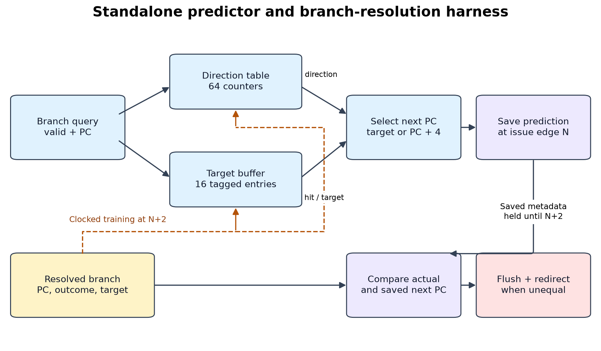
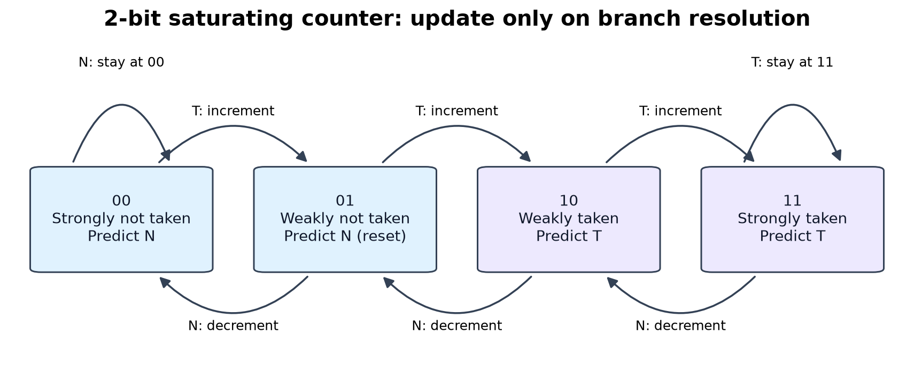

# Design and interfaces

## Architecture

`branch_predictor` combines `direction_predictor` and `branch_target_buffer`.
`branch_recovery` is a separate processor-facing interface. The testbench supplies
known branch addresses from a committed architectural trace. It does not decode
instructions, execute a CPU, or issue wrong-path instructions.

| Signal | Direction | Meaning |
|---|---|---|
| `clk`, `reset` | Input | Rising clock; synchronous active-high reset, priority over updates |
| `query_valid`, `query_pc` | Input | Query is a known conditional branch; 4-byte aligned address |
| `predicted_taken` | Output | Raw direction prediction, gated by `query_valid` |
| `btb_hit` | Output | Valid, matching target-buffer tag; gated by `query_valid` |
| `predicted_next_pc` | Output | Target only when direction is taken and BTB hits; otherwise `query_pc + 4` |
| `query_state[1:0]` | Output | Current indexed counter for explanation/debug; not gated by valid |
| `update_valid`, `update_pc` | Input | Exactly one resolved conditional-branch update at a rising edge |
| `actual_taken`, `actual_target` | Input | Resolved outcome and target; target trained only for taken branches |

Baseline always reports not taken, and debug state `00`. Its BTB still trains and
reports hits so target statistics have the same definition for all three modes.
Baseline selection never uses the target. Dynamic modes train the BHT on **every
valid resolved branch**, including not-taken outcomes. `query_valid` does not gate
independent resolution updates.

Supported parameters: `MODE=0/1/2`, `ADDR_WIDTH>=3`, positive BHT/BTB index widths
with `index_width+2 < ADDR_WIDTH`. Defaults are 32, 6, and 4. Address arithmetic
wraps to `ADDR_WIDTH`; compressed instructions and unaligned inputs are outside
the contract. The trace runner rejects unaligned PCs/targets.

### Tables

BHT index is `PC[7:2]` by default. Entries are untagged: branches separated by
256 bytes share state intentionally. A 1-bit table resets to `0`; a 2-bit table
resets to `01`. Taken increments and not taken decrements the 2-bit counter,
clamping to `00..11`; its most significant bit supplies direction.

BTB index is `PC[5:2]`, tag `PC[31:6]`. Each of 16 entries contains one valid bit,
26 tag bits, and a 32-bit target: 944 logical storage bits total. Reset clears
valid bits, masking uninitialized tag/target contents. Taken updates replace the
indexed entry; not-taken updates leave the BTB untouched. The BHT adds 0, 64, or
128 logical bits. These logical counts are distinct from synthesized FPGA resources.

A BTB miss can coexist with a taken direction prediction: next-PC falls through,
but the direction statistic still records the original taken guess. A correct
direction can coexist with a stale target and a required flush.

### Recovery interface

Inputs: `resolve_valid`, `resolved_pc`, `actual_taken`, `actual_target`, and
`saved_predicted_next_pc`. Outputs: `redirect_pc` and `flush`.

`redirect_pc` is the actual target when taken, otherwise `resolved_pc + 4`.
`flush` is asserted only while `resolve_valid` is true and this address differs
from the **saved launch-time** prediction. `redirect_pc` is combinational even
when invalid; a consumer acts only on a valid flush. A branch whose target equals
fallthrough may have wrong direction but need no next-address recovery.

## Harness timing and update ordering

For each branch, the testbench drives the query before issue edge N and saves
state, direction, BTB hit, and next-PC. It deasserts query-valid, presents resolution
before edge N+2, checks recovery against the saved address, then updates tables
at N+2. No following branch is queried until the previous update completes.

Combinational reads show old state before a write edge and new state after its
nonblocking update settles. The saved prediction never changes. Queries do not
train the tables. No speculative state updates or rollback are implemented.
This harness is an interface demonstration with one outstanding branch; it omits
overlap, wrong-path execution, stalls, and pipeline fill/drain effects. Its clock
count must not be used as measured CPU CPI.

## Trace format and reproducibility

`traces/manifest.json` schema version 1 records a fixed random seed, workload names,
total instruction count, branch count, and records containing `pc`, `target`, `op`,
`lhs`, `rhs`, `taken`, and `instructions_before`. Operands are unsigned 32-bit
values. BEQ compares equality; BNE compares inequality. The generator and runner
independently derive/check outcomes from these operands.

Each `.mem` line contains `pc_hex taken_decimal target_hex`, with no header.
`total_instructions = sum(instructions_before + 1)` over branch records; there
are no trailing instructions in these workloads. These are synthetic committed
traces with documented instruction density, not benchmark binaries or wall-clock
measurements. Both the predictor and the oracle start cold for each workload.

Raw CSV rows contain launch-time predictions and resolution-time recovery, in
trace order. The runner requires every field and every row to match the independent
Python oracle before publishing the summary. `verification.json` records the
manifest SHA-256, seed, tool versions, comparison count, and CPI assumptions.

## FPGA evaluation wrapper

`timing_top` has five physical ports: clock, reset, serial input, load, serial output.
It includes a 131-bit input shift register, a 131-bit request register, a transaction
valid flip-flop, and a 69-bit response register (332 logical transport flip-flops).
Optimization can merge, eliminate, or remap logic; these counts are not additive
with post-synthesis predictor resources.

Shift a request MSB first, then assert `load` for one rising edge. Deassert load.
On the next rising edge, capture the pre-update result and perform any requested
predictor update exactly once. Sample the response MSB first before each subsequent
rising edge; each edge shifts the next response bit into position.

Request bit layout:
`{actual_taken, update_valid, query_valid, saved_next[31:0], target[31:0], update_pc[31:0], query_pc[31:0]}`.

Response bit layout:
`{redirect_pc[31:0], flush, btb_hit, predicted_taken, query_state[1:0], predicted_next_pc[31:0]}`.

The full wrappers contain predictor + recovery + transport. `FIXTURE_ONLY=1`
replaces predictor/recovery with a combinational XOR that observes every request
bit. Its measured resources give a **separate fixture reference**, not an exact
quantity to subtract. Timing/resource numbers are for the mapped full wrapper;
register boundaries can permit RAM mapping that differs from a bare asynchronous
predictor. The serial protocol is not predictor throughput.

Yosys maps to iCE40 cells; nextpnr routes HX8K CT256 at a 25 MHz constraint and
fixed seed 1. Automatic pin placement is intentional for tool-only evaluation;
these are not board pin assignments. Reported Fmax is the tool's routed internal
clock-path estimate. No external I/O timing, board behavior, or hardware-proven
maximum frequency is claimed. Logs and machine-readable reports are retained.

## Sources

- Supplied Project_list_MCA.pdf: Project 5 and sections 4–5.
- [Cornell branch-prediction exercises](https://www.csl.cornell.edu/courses/ece4750/handouts/ece4750-T10-ap-branchpred-problems.pdf).
- [Yosys documentation](https://yosyshq.readthedocs.io/projects/yosys/en/latest/).
- [nextpnr and supported devices](https://github.com/YosysHQ/nextpnr).
