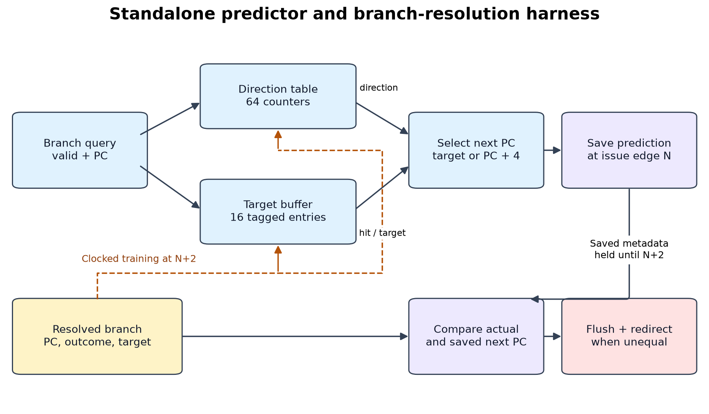
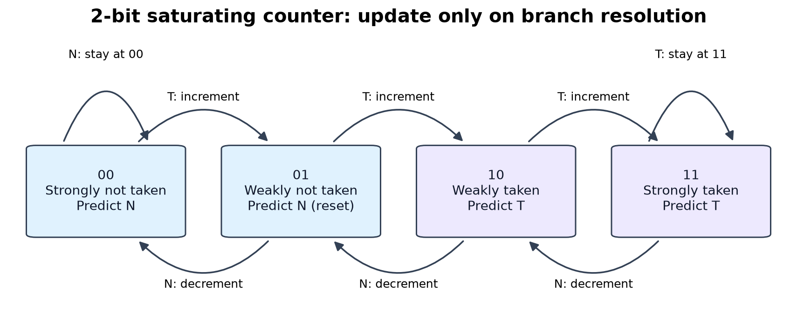
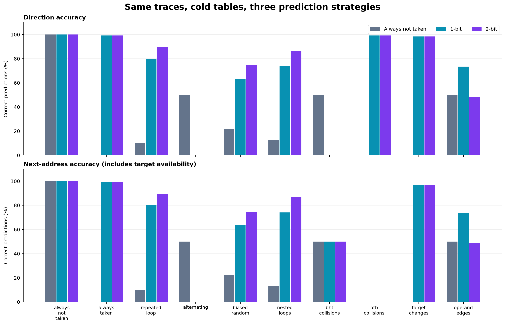
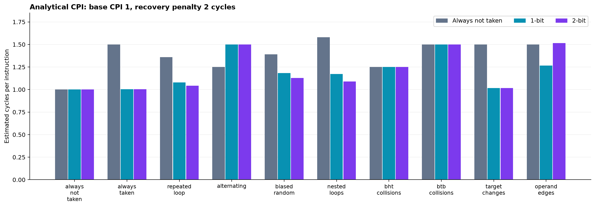
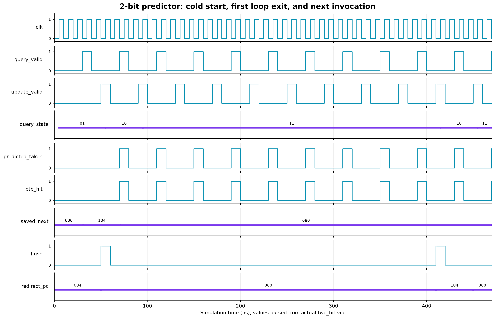

# Dynamic Branch Prediction Unit — Technical Report

## 1. Objective and requirements

Design and evaluate a hardware branch-prediction unit that reduces control-hazard
recovery penalties. This implements Project 5 from the supplied *Project_list_MCA.pdf*,
including the common requirements for modular synthesizable RTL, directed testbench,
waveform verification, quantitative comparison, synthesis resources, timing estimates,
a report, and a live demonstration. A complete CPU is not explicitly required for
Project 5; this implementation uses a standalone predictor and branch-resolution harness.

## 2. Microarchitecture

The three strategies are always not taken, a 1-bit last-outcome predictor, and a
2-bit saturating predictor. They share the same external interface and target-buffer
policy. All addresses are 32-bit with 4-byte instruction alignment. BHT entries are
indexed by PC bits 7:2; the 16-entry tagged BTB uses bits 5:2 and tags 31:6.
Reset initializes 1-bit entries to 0, 2-bit counters to 01, and BTB valid bits to 0.

Direction is the counter's most significant bit. Taken increments and not taken
decrements with saturation. BTB entries are populated/replaced only on taken
resolution. A missing target forces next-address prediction to PC+4, even if the
direction predictor says taken. Resolution compares the actual next address to the
saved original prediction to drive flush and redirect. Read/update ordering,
complete interfaces, and wrapper protocol are specified in [design.md](../docs/design.md).

## 3. Workloads and methodology

All strategies run identical committed traces with cold tables for each independent
workload. Outcomes are derived from BEQ/BNE operands, not guessed by a predictor.
Seed: **20261018**. Branch frequency is derived from the actual synthetic
workload record count and its explicitly recorded retired nonbranch instruction count.
No warm-up branches are excluded.

| Workload | Branches | Instructions | Branch frequency |
| --- | --- | --- | --- |
| always_not_taken | 128 | 512 | 25.00% |
| always_taken | 128 | 512 | 25.00% |
| repeated_loop | 320 | 1600 | 20.00% |
| alternating | 256 | 1024 | 25.00% |
| biased_random | 512 | 2048 | 25.00% |
| nested_loops | 432 | 1296 | 33.33% |
| bht_collisions | 256 | 1024 | 25.00% |
| btb_collisions | 256 | 1024 | 25.00% |
| target_changes | 64 | 256 | 25.00% |
| operand_edges | 64 | 128 | 50.00% |

The harness saves a prediction at issue edge N and resolves/updates at edge N+2,
with one outstanding branch. It does not model a complete executing processor,
wrong-path instructions, instruction overlap, other hazards, or pipeline fill/drain.
Target-change traces are deliberately adversarial interface tests; changing targets
at one static PC are not typical of direct BEQ/BNE code. Nested-loop traces represent
repeated calls; ordinary call/return instructions are not simulated.

Definitions:

- Direction accuracy = correct taken/not-taken guesses / all branch queries.
- Next-address accuracy = correct next addresses / all branch queries.
- BTB hit rate = tag/valid hits / all branch queries, including not-taken queries.
- Recovery count = next-address mismatches; a direction mismatch alone need not flush
  if target and fallthrough happen to be equal.
- Branch frequency = branch count / total retired instruction count.

`estimated_CPI = base_CPI + branch_frequency × next_address_miss_rate × recovery_penalty`

For this run: base CPI **1.0**, penalty **2** cycles.
Equivalently, CPI = base CPI + recoveries × penalty / total instructions. Speedup is
baseline CPI divided by strategy CPI at a common assumed instruction clock.
These are **analytical estimates**, not measured CPU performance or serialized
harness cycle counts. The two-cycle harness resolution delay and analytical
recovery penalty are separate settings that share a default value.

## 4. Results and interpretation

| Workload | Strategy | Direction correct | Next-address correct | BTB hit rate | Recoveries | Estimated CPI |
| --- | --- | --- | --- | --- | --- | --- |
| always_not_taken | Always not taken | 100.00% | 100.00% | 0.00% | 0 | 1.00000 |
| always_not_taken | 1-bit | 100.00% | 100.00% | 0.00% | 0 | 1.00000 |
| always_not_taken | 2-bit | 100.00% | 100.00% | 0.00% | 0 | 1.00000 |
| always_taken | Always not taken | 0.00% | 0.00% | 99.22% | 128 | 1.50000 |
| always_taken | 1-bit | 99.22% | 99.22% | 99.22% | 1 | 1.00391 |
| always_taken | 2-bit | 99.22% | 99.22% | 99.22% | 1 | 1.00391 |
| repeated_loop | Always not taken | 10.00% | 10.00% | 99.69% | 288 | 1.36000 |
| repeated_loop | 1-bit | 80.00% | 80.00% | 99.69% | 64 | 1.08000 |
| repeated_loop | 2-bit | 89.69% | 89.69% | 99.69% | 33 | 1.04125 |
| alternating | Always not taken | 50.00% | 50.00% | 99.61% | 128 | 1.25000 |
| alternating | 1-bit | 0.00% | 0.00% | 99.61% | 256 | 1.50000 |
| alternating | 2-bit | 0.00% | 0.00% | 99.61% | 256 | 1.50000 |
| biased_random | Always not taken | 22.07% | 22.07% | 99.61% | 399 | 1.38965 |
| biased_random | 1-bit | 63.48% | 63.48% | 99.61% | 187 | 1.18262 |
| biased_random | 2-bit | 74.41% | 74.41% | 99.61% | 131 | 1.12793 |
| nested_loops | Always not taken | 12.96% | 12.96% | 99.54% | 376 | 1.58025 |
| nested_loops | 1-bit | 74.07% | 74.07% | 99.54% | 112 | 1.17284 |
| nested_loops | 2-bit | 86.57% | 86.57% | 99.54% | 58 | 1.08951 |
| bht_collisions | Always not taken | 50.00% | 50.00% | 49.61% | 128 | 1.25000 |
| bht_collisions | 1-bit | 0.00% | 50.00% | 49.61% | 128 | 1.25000 |
| bht_collisions | 2-bit | 0.00% | 50.00% | 49.61% | 128 | 1.25000 |
| btb_collisions | Always not taken | 0.00% | 0.00% | 0.00% | 256 | 1.50000 |
| btb_collisions | 1-bit | 99.22% | 0.00% | 0.00% | 256 | 1.50000 |
| btb_collisions | 2-bit | 99.22% | 0.00% | 0.00% | 256 | 1.50000 |
| target_changes | Always not taken | 0.00% | 0.00% | 98.44% | 64 | 1.50000 |
| target_changes | 1-bit | 98.44% | 96.88% | 98.44% | 2 | 1.01562 |
| target_changes | 2-bit | 98.44% | 96.88% | 98.44% | 2 | 1.01562 |
| operand_edges | Always not taken | 50.00% | 50.00% | 98.44% | 32 | 1.50000 |
| operand_edges | 1-bit | 73.44% | 73.44% | 98.44% | 17 | 1.26562 |
| operand_edges | 2-bit | 48.44% | 48.44% | 98.44% | 33 | 1.51562 |

- **Repeated loops:** recoveries are 288, 64, 33 for baseline,
  1-bit, and 2-bit. Corresponding analytical CPI is 1.36000, 1.08000, 1.04125.
  The 2-bit strategy's estimated speedup over baseline is 1.306x under these assumptions.
- **Why 2-bit helps here:** 1-bit misses the first taken branch and the exit on each
  invocation. 2-bit misses initial training and each exit, retaining taken direction
  for the next invocation. There are 32 invocations of nine taken branches followed
  by one not-taken exit.

- **Alternating outcomes:** both dynamic predictors oscillate out of phase from
  their chosen reset states and score zero direction accuracy on this trace. The
  always-not-taken baseline achieves 50%. Two-bit is not universally superior.
- **BTB collisions:** independent BHT entries learn both taken branches, but the
  alternating addresses evict each other's BTB entries. Next-address accuracy is
  zero despite high direction accuracy.
- **BHT collisions:** opposing outcomes interfere in the shared counter. Direction
  accuracy and next-address accuracy differ because a BTB miss falls through and
  can accidentally select the correct next address on not-taken branches.
- **Target changes:** after warm-up the direction is correct, but a stale stored
  target causes an additional recovery when the target changes.

Raw counters and full precision values are in [accuracy.csv](accuracy.csv).
Each launch-time state, prediction, target hit, actual next address, and flush is
retained in [raw/](raw/). No averaged score across arbitrary synthetic workloads is
used to claim overall performance.

## 5. Verification evidence

- Directed Verilog checks: **90 passed**. All eight state/outcome transitions,
  saturation, reset priority, disabled updates, query-valid gating, BHT indexing,
  BHT aliasing, BTB tags/replacement, target retention, changed targets, saved
  prediction recovery, invalid resolution, and address wraparound are covered.
- Independent hand-calculated Python cases: **5**.
  These check loop miss totals, alternation, operand semantics, target correctness,
  and BTB replacement against known expected counts.
- RTL/oracle comparisons: **7,248 passed** across
  **10 workloads × 3 strategies**.
  Every prediction field and every recovery is compared, not just aggregate accuracy.
- Serial wrapper: three transactions test cold prediction, learned prediction,
  output ordering, and absence of repeated updates during serial shifting.
- Post-synthesis functional simulation reruns the serial wrapper transactions for
  each mapped strategy using Yosys's iCE40 primitive models. This is a directed
  functional check, not exhaustive equivalence or timing simulation.
- Verilator checks all three predictor modes, recovery, and the wrapper. Only
  deliberate unused-address/parameter-specialization warnings are suppressed.

The preview is parsed from the actual 2-bit VCD (not a reconstructed ideal waveform).
At cold start, saved next-PC is 0x104; a taken resolution flushes to 0x80. Subsequent
predictions use the learned target. At the loop exit, recovery redirects to 0x104;
the counter remains weakly taken for the next loop invocation.
VCD files are in [waveforms/](waveforms/), with a GTKWave signal list in
[loop.gtkw](../docs/loop.gtkw). Machine-readable evidence is in
[verification.json](verification.json), [unit_checks.json](unit_checks.json), and
[synthesis/gate_checks.json](synthesis/gate_checks.json).

## 6. Synthesis and timing

Target: **Lattice iCE40 HX8K CT256**. Clock constraint: **25 MHz**. Place-and-route seed: **1**.
All four configurations meet the constraint.

| Wrapped strategy | Logic cells / 7680 | LUT4s | Flip-flops | 4K RAM blocks | Estimated Fmax (MHz) |
| --- | --- | --- | --- | --- | --- |
| always_not_taken | 592 | 292 | 375 | 2 | 93.92 |
| one_bit | 961 | 563 | 477 | 4 | 77.37 |
| two_bit | 1198 | 737 | 547 | 4 | 71.41 |
| fixture_reference | 337 | 72 | 332 | 0 | 324.36 |

These are measured tool outputs for **predictor + recovery + registered serial
transport**, and a separate fixture reference. The fixture contains 332 logical
transport flip-flops; its XOR observes all request bits. Optimization and FPGA
packing mean its resources cannot simply be subtracted to claim bare predictor
area. Baseline retains the BTB hit observation output, so it also has target storage.
LUT4 and flip-flop counts come from the mapped Yosys netlist; packed logic-cell
and RAM counts come from nextpnr. RAM and LUT mapping depend on register boundaries
and tool optimizations.

Fmax is a routed **internal clock-path estimate**, not a physical-board measurement
or externally constrained I/O guarantee. The serial wrapper affects the critical
path and does not describe a processor's instruction throughput. Automatic pin
placement is an evaluation choice; no board pin assignment or hardware test is claimed.

Tools: `Yosys 0.70+post (git sha1 0c11ea098be065e585a90a06e7b7da49936cf231, Release, AppleClang clang++ 21.0.0.21000334)`; `nextpnr-ice40 0.11.1_2`.
The nextpnr executable reports an empty version string; its SHA-256 is retained in
[tools.json](synthesis/tools.json). Full synthesis logs, routed timing reports,
utilization JSON, and post-synthesis gate checks are in [synthesis/](synthesis/).

## 7. Reproduction, demonstration, and limitations

Run `make all` to regenerate tests, lint, traces, experiments, synthesis, and this
report. Run `make demo` for the repeated-loop walkthrough. See the
[live demonstration guide](../docs/demo.md) for a 5–7 minute presentation sequence.

This project demonstrates the required prediction, update, target, and recovery
behavior. It deliberately excludes a complete CPU, speculative rollback, multiple
outstanding branches, global history predictors, physical board validation, and
claims about real-program speedup. Synthetic instruction density and a constant
recovery penalty simplify the analytical CPI model. No external hardware is needed
for the delivered results.

## References

1. Supplied *Project_list_MCA.pdf*, Project 5 and Common Project Requirements.
2. [Cornell ECE 4750 branch-prediction exercises](https://www.csl.cornell.edu/courses/ece4750/handouts/ece4750-T10-ap-branchpred-problems.pdf).
3. [Yosys documentation](https://yosyshq.readthedocs.io/projects/yosys/en/latest/).
4. [nextpnr official repository](https://github.com/YosysHQ/nextpnr).
